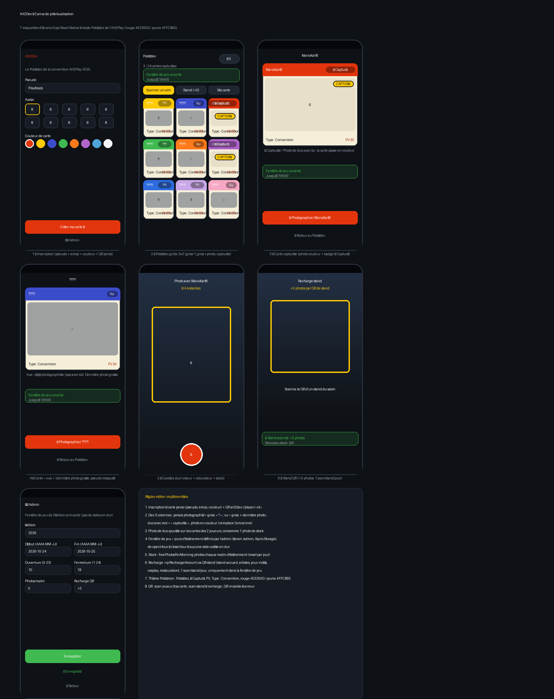

# Art2Dex — le Pokédex de l'Art2Play

App mobile **Expo React Native (SDK 58)** en mode Pokédex pour la convention **Art2Play** :
les visiteurs s'inscrivent à l'avance, reçoivent une carte perso + un QR code personnel,
et « capturent » les autres participants en prenant des **photos de duo** avec eux.


[Vue HTML du canva](preview/canvas.html) — régénéré en PNG via `python3 preview/gen_canvas.py`

## Concept

- **Inscription à l'avance** → carte perso (pseudo, emoji avatar, couleur) + QR personnel `art2dex://player/<id>`.
- **Dex en grille 3 colonnes** (style Pokédex, palette rouge `#E3350D` / jaune `#FFCB05`).
- **Photo de duo** avec un autre joueur → la photo est ajoutée sur les cartes des **2 joueurs** et consomme **1 photo de stock**.
- **2 modes de jeu** (réglables dans l'admin) :
  - **Classique** : scanner le **QR personnel** d'un joueur débloque directement sa carte (`scan-friend.tsx` → `unlockWithQr()`).
  - **Collection** : un groupe se crée (`collection.tsx`) ; les photos du groupe restent **masquées et regroupées** pendant l'event et ne sont **révélées qu'à la fin** (`isEventOver()` / révélation manuelle) ; la photo affichée sur les cartes est la **photo du jour** définie chaque matin par le joueur (`my-card.tsx` → `setDailyPhoto()`) ; la prise de photo avec un joueur se valide en entrant son **code temporaire type MFA** (6 chiffres, TTL court, usage unique — `utils/validationCode.ts`, `enter-code.tsx`).
- **Carte holographique** : à chaque déblocage (QR ou code), faible probabilité d'obtenir la version **✨ holo** (`holoChanceClassic`, ex. 2 %) — **plus élevée si la carte fait partie d'une collection** (`holoChanceCollection`, ex. 15 %), seuils configurables dans l'admin (`utils/holo.ts`).
- **Fenêtre de jeu** : uniquement les jours d'événement définis par l'admin, de `openHour` à `closeHour`.
- **Stock de photos** : `freePhotosPerMorning` photos offertes chaque matin d'événement (reset par jour d'event) ; recharge de `+qrRechargeAmount` en scannant un QR de stand (1 scan/stand/jour, uniquement dans la fenêtre de jeu).

## Règles métier → implémentation

| Règle | Implémentation |
|---|---|
| Inscription → carte + QR perso | `src/app/register.tsx`, `register()` dans `src/store/DexContext.tsx`, `playerQr()` dans `src/utils/qr.ts` |
| Carte jamais photographiée | grise + « ? » : `getCardView()` → `unknown` dans `src/services/game.ts`, overlay gris dans `src/components/CardVisual.tsx` |
| Carte photographiée (pas avec moi) | grise + **dernière photo** grisée : `status: 'seen'` dans `getCardView()` |
| Photo de duo avec moi | « capturée », photo en couleur, remplace l'ancienne : `status: 'captured'` + `addDuoPhoto()` sur les 2 cartes |
| Fenêtre de jeu admin, pas de dates en dur | écran `src/app/admin.tsx` (validation AAAA-MM-JJ, horaires, entiers ≥ 0), persisté dans AsyncStorage clé `art2dex/state/v1` (`src/services/storage.ts`), testé par `isPlayWindow()` dans `src/utils/eventWindow.ts` ; valeurs par défaut dans `src/config.ts` (2025-10-25/26, 9h–19h, 5 photos, +5) |
| Stock : reset chaque matin d'event | `effectiveStock()` dans `src/utils/photoStock.ts` (reset par `dayKey`) |
| Recharge QR stand, 1 scan/stand/jour, fenêtre ouverte uniquement | `rechargeFromStand()` dans `src/store/DexContext.tsx` (clé `<stand>@<jour>`), stands listés dans `src/config.ts` : stand-accueil, stand-artistes, stand-jeux-indes, stand-cosplay, stand-restauration |
| Thème Pokédex | `src/theme.ts`, `CardVisual.tsx` (« ★ Capturé », PV, « Type : Convention ») |
| Mode Classique : scan QR joueur → carte débloquée | `unlockWithQr()` dans `src/store/DexContext.tsx`, `addQrUnlock()` dans `src/services/game.ts`, `src/app/scan-friend.tsx` |
| Mode Collection : photos de groupe masquées jusqu'à la fin de l'event | `CollectionGroup` + `resolveCardView()`/`cardPhotoInCollection()` dans `src/services/game.ts`, `isEventOver()` dans `src/utils/eventWindow.ts`, écran `src/app/collection.tsx` |
| Photo du jour sur les cartes (définie le matin même) | `DailyPhoto` sur `Player`, `setDailyPhoto()` dans `DexContext`, sélecteur d'emoji dans `src/app/my-card.tsx` |
| Validation par code temporaire type MFA (6 chiffres, TTL, usage unique) | `src/utils/validationCode.ts` (pur, digest injecté), `getValidationCode()`/`validateWithCode()` dans `DexContext` (SHA-256 via `expo-crypto`), écrans `my-card.tsx` (code affiché) et `enter-code.tsx` (saisie) |
| Carte holographique : proba faible, plus forte en collection | `src/utils/holo.ts` (`holoChance`, `rollHolographic`), chances dans `GameConfig` (admin), badge ✨ HOLO dans `CardVisual.tsx` |

## Commandes

```bash
npm install          # dépendances
npm start            # Expo Go / dev build
npm run android      # ou ios / web
npm run typecheck    # tsc --noEmit
npm run lint         # expo lint
npm test             # smoke tests métier (tsx scripts/smoke.ts)
```

## Structure

```
src/
  app/            routes Expo Router (root: ./src/app)
    _layout.tsx     AuthProvider + DexProvider + Stack
    index.tsx       redirection login/register/dex selon session
    login.tsx       connexion/création de compte OAuth (5 providers)
    register.tsx    inscription (pseudo, emoji, couleur) → /dex
    dex.tsx         Pokédex grille 3 colonnes
    card/[id].tsx   fiche carte + bouton « Photographier »
    duo-camera.tsx  caméra selfie → photo de duo
    scan-friend.tsx scan QR joueur → débloque sa carte (mode classique)
    scan-stand.tsx  scan QR stand → recharge
    collection.tsx  groupes de collection, galerie masquée/révélée
    enter-code.tsx  saisie du code temporaire de validation (mode collection)
    my-card.tsx     ma carte + QR + stats + mes photos
    admin.tsx       édition fenêtre de jeu annuelle
  components/     CardVisual, PlayerCard, DexHeader, WindowBanner, ScannerShell, ProviderButton
  data/           mockPlayers.ts (24 joueurs de démo, 8 duos pré-liés)
  hooks/          useNow.ts (horloge rafraîchie), useProviderSignIn.ts (flux OAuth/Apple par provider)
  services/       game.ts (états de carte, addDuoPhoto), storage.ts (AsyncStorage), auth.ts (session),
                  authProviders.ts (discovery/scopes/normalisation par provider), secureStorage.ts (tokens)
  store/          AuthContext.tsx (session OAuth), DexContext.tsx (cœur de l'app)
  utils/          eventWindow, photoStock, qr, id, reasons, jwt (decode payload), session (expiry)
  config.ts       valeurs par défaut + stands + préfixes QR
  theme.ts        palette
preview/          canvas.html (canva autonome) + gen_canvas.py + canvas.png
scripts/          smoke.ts (tests métier Node)
```

## Configuration admin (chaque année)

Depuis l'écran d'inscription (« ⚙️ Admin ») ou « Ma carte » : nom/édition de l'événement,
`startDate`/`endDate` au format `AAAA-MM-JJ` (début ≤ fin), `openHour` (0–23) < `closeHour` (1–24),
`freePhotosPerMorning` et `qrRechargeAmount` (entiers ≥ 0). Tout est validé puis persisté dans
AsyncStorage (`art2dex/state/v1`) — **aucune date n'est codée en dur dans l'app**.

Valeurs par défaut (`src/config.ts`) : Art2Play 2025, du 2025-10-25 au 2025-10-26, 9h00–19h00, 5 photos/matin, +5 par QR de stand.

## Connexion / création de compte (providers OAuth)

Écran `src/app/login.tsx` : **se connecter ou créer un compte** avec Google, Apple, Microsoft, Discord ou Twitch.
Le même flux sert à la connexion et à la création de compte (le provider crée le compte à la première connexion).
Après connexion, si aucune carte n'existe encore → écran `/register` (pseudo pré-rempli depuis le provider) pour créer la carte et le QR.

- **Google, Microsoft, Discord, Twitch** : flux navigateur OAuth2/OIDC + PKCE via `expo-auth-session` (`src/hooks/useProviderSignIn.ts`), endpoints statiques dans `src/services/authProviders.ts`. Aucun client secret requis côté mobile (Discord : activer le flag « Public client », ou renseigner `EXPO_PUBLIC_DISCORD_CLIENT_SECRET`).
- **Apple** : natif iOS via `expo-apple-authentication` (`usesAppleSignIn: true`, obligatoire App Store quand d'autres providers sont proposés). Sur Android/web : flux web `appleid.apple.com` si `EXPO_PUBLIC_APPLE_WEB_CLIENT_ID` + `EXPO_PUBLIC_APPLE_CLIENT_SECRET` (JWT signé) sont configurés.
- **Session** : profil en AsyncStorage (`art2dex/auth/v1`, `src/services/auth.ts`), tokens en `expo-secure-store` (`src/services/secureStorage.ts`, fallback AsyncStorage sur web). Déconnexion depuis « Ma carte ».
- **Config** : client IDs en variables `EXPO_PUBLIC_*` — copier `.env.example` en `.env`. Redirect URI à enregistrer chez chaque provider : `art2dex://` (dev build / standalone ; `exp://…` sous Expo Go, web : URL de l'app).
- Les modules natifs ajoutés (`expo-apple-authentication`, `expo-secure-store`) nécessitent un **dev build** (`eas build --profile development`), pas Expo Go.

## Synchro backend (future)

L'état local (AsyncStorage) est isolé dans `src/services/storage.ts` (`loadState`/`saveState`, clé `art2dex/state/v1`) :
remplacer ces deux fonctions par des appels **Supabase** ou **Firebase** (Firestore) synchronise tout le dex
(cartes, photos, stock, scans de stands, config admin) entre les appareils, sans toucher au reste de l'app.
Les photos (`uri`) seraient uploadées vers un bucket (Supabase Storage / Firebase Storage) et remplacées par des URLs publiques.

## Hypothèses

- Mode démo hors ligne : 24 joueurs fictifs (`src/data/mockPlayers.ts`) ; en prod, remplacés par la synchro backend.
- Les photos de démo ont `uri: null` et utilisent une tuile emoji ; une vraie photo de duo stocke l'`uri` caméra.
- Une seule preview caméra active à la fois (navigation `router.replace` entre écrans caméra).
- Grisé des cartes via overlay `rgba(140,145,152,0.78)` (pas de filtre Image en RN core).
